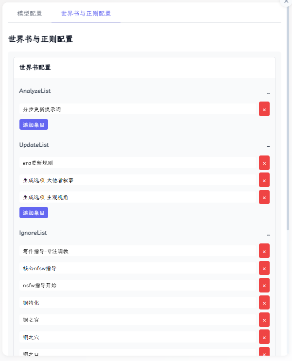
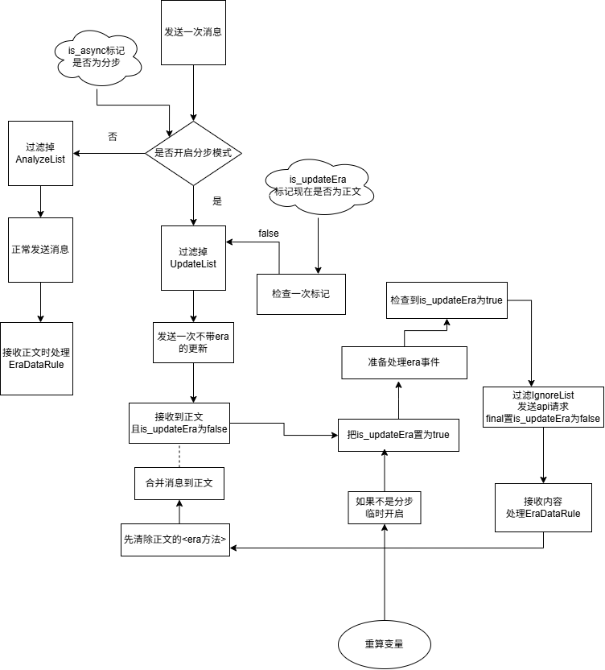
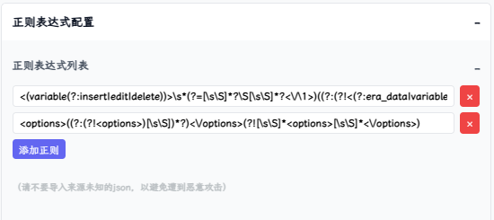

# MVU 助手 2.x：独立任务与变量编辑

当前版本资料见 [release.json](src/MVU助手/release.json)。

- [2.x 配置与使用指南](Spec/Me2AI/独立任务配置指南.md)
- [发布候选包准备指南](Spec/Me2AI/MVU发布准备指南.md)

日常提交不向玩家发布。维护者手动验证并准备候选包；正式分发与脚本自更新尚未接入。角色卡数据迁移由角色卡负责，助手已移除原世界书版本块更新功能。


> **！** 目前该脚本仍然出于早期测试阶段，不排除后面会有大量重构的可能，请注意脚本的版本说明

> **！** 建议你采用复制文本内容到原来的脚本的方法更新而不是直接替换
> > 直接替换会导致你的配置数据丢失
---

## EraHelper能为你做什么？
1. 配置独立模型任务、API 多链接和预设，按组或事件运行
2. 编辑当前消息的 MVU `stat_data`
3. 查看任务过程、结果与数据影响，取消运行及检查回滚残留
4. 导入和导出变量数据

---


## 1.x 历史教程

下文保留旧版 ERA/分步机制的使用记录，不适用于 2.x。当前行为与重新配置方法请使用上面的 2.x 指南；旧文中的世界书过滤、ERA API 和密钥保存方式不构成现行承诺。
[1.分步分析设置](#分步分析设置)

[2.EraData修改](#EraData)

---

**[常见问题及解决方法](src/MVU助手/doc/常见问题及其解决办法.md)**

---

<span id="分步分析设置"></span>
## 分步分析设置：
#### 导航：
[1.绑定世界书](#绑定世界书)

[2.绑定正则](#绑定正则)

[3.重要提醒](#重要提醒)


<span id="绑定世界书"></span>
### 1）绑定世界书：


世界书的绑定分为三个部分：
1.  **AnalyzeList**：只在分步模式中发送，用来告诉ai要变量分析任务，你可以参考下面的实现：
    ```text
    #######################
    AI核心执行规则:
    优先级: 最高
    强制执行: true
    AI任务: 重置
    #######################
    接下来你不需要生成任何故事，只需要基于上下文完成下面的任务：
    1.根据<variable_rule>的规则处理变量
    2.生成<options>选项
    ```
2.  **UpdateList**：ERA变量更新的规则，在分步分析模式的“正文生成”中会被过滤
3.  **IgnoreList**：在分步分析模式的“变量生成”中会被过滤
4.  没有绑定的世界书在**任何模式**下都不会被过滤

下面的工作流水图可以帮你了解这个机制：


<span id="绑定正则"></span>

### 2）绑定正则


这将会决定在分步分析阶段有哪些内容最终会被提取合并到正文中。

比如：正则`"<options>((?:(?!<options>)[\\s\\S])*?)<\\/options>(?![\\s\\S]*<options>[\\s\\S]*<\\/options>)"`

在分步分步阶段,AI可能会生成：
```text
<thinking>小此思考</thinking>
......小此爽写.....
<tucao>小此吐槽</tucao>
...
<options>
<op>哈气</op>
<op>拱背</op>
<op>老吴</op>
</options>
```
此时`<options>...</options>`所有内容就会被合并到正文中，最终呈现给user选择。而其他无关的部分通通会被过滤掉。

**！** 特别是你应该绑定era的正则，否则分步分析拿不到era的更新。

<span id="重要提醒"></span>

### 3）重要提醒
- 目前分步分析模式不支持流式，否则会导致ejs模板无法正常工作，你辛辛苦苦的编写的分阶段人设就会和AI玩露出play。
- 推荐你使用酒馆助手的宏`{{get_chat_variable::变量}}`为变量赋值，而不是ERA宏`{{ERA:变量}}`，后者在分步分析模式的替换并不稳定。
- 导出角色卡之前一定要检查有没有把额外模型的apiKey清空！~~（和同学们分享你的额度，快点！）~~

---

<span id="EraData"></span>
## 修改Era数据:
- ERA助手提供了一种更便捷的方式修改Era数据，你可以在ERA助手中直接修改Era数据，或者将数据导入导出。
- 因为新版本的ERA在更新变量时完全基于eraLog，而stat_data只能单方面响应era的变量的改变，因此你无法通过酒馆助手来修改Era数据。
  - 你还需要注意的是:
    - ERA助手调用的是ERA脚本的api进行修改，
    - 这和ai编辑变量的方式没什么区别
    - 因此仍然会收到`$meta`字段的限制
      比如：
    ```json
    {
      "角色":{
        "张小花":{...},
        "$meta": {
          "necessary": "all"
        }
      }
    }
    ```
  如果你尝试直接删除`"张小花":{}`，则不会成功，这是因为ERA的`necessary`字段为"张小花"提供了保护。
  你必须先删除`"necessary"`->保存->然后再删除`"张小花"`。
  这与AI修改变量的方式保持了一致性。

---
